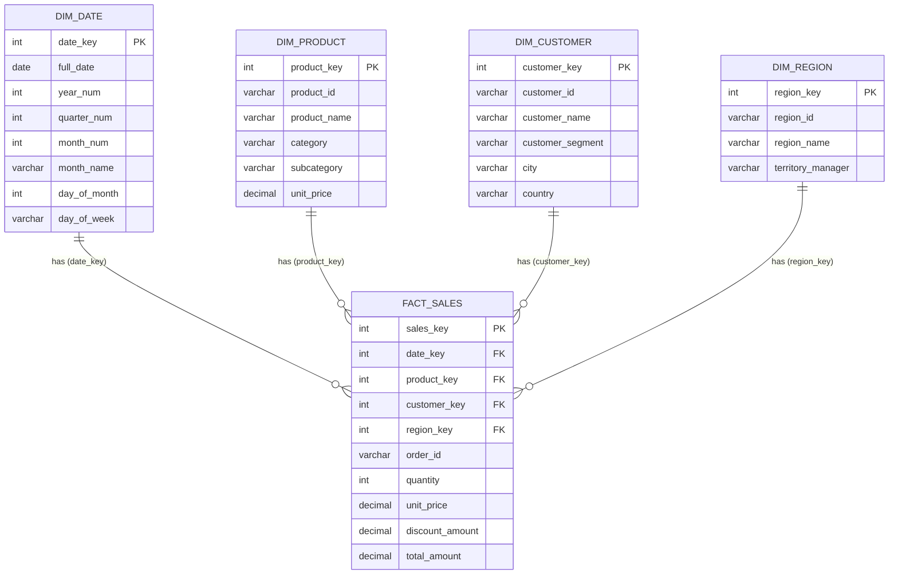

# SQL Dimensional Report — Week 5 Project

A comprehensive, student-friendly SQL data warehousing and dimensional reporting project implementing a **Star Schema**, **Window Function Rankings**, **CTE-based Month-over-Month (MoM) Growth Analysis**, **ROLLUP Multi-Level Aggregations**, and **EXPLAIN Query Optimization**.

---

## 📌 Project Overview

In analytical database design (OLAP), dimensional modeling organizes business data for fast, intuitive querying. This project models a retail sales warehouse using a central **Fact Table** (`fact_sales`) surrounded by four **Dimension Tables** (`dim_date`, `dim_product`, `dim_customer`, `dim_region`).

### Key Features Implemented:
1. **Star Schema Architecture**: Clean relational structure with primary/foreign keys and foreign key indexes.
2. **Window Function Rankings**: Comparative analysis using `ROW_NUMBER()`, `RANK()`, and `DENSE_RANK()`, including regional partitions (`PARTITION BY`).
3. **CTE-Based MoM Growth Report**: Multi-stage CTE pipeline calculating monthly revenue, previous month lookup via `LAG()`, absolute growth, percentage growth, and trend indicators.
4. **ROLLUP Aggregations**: Hierarchical subtotals and grand totals across geographical and product dimensions.
5. **EXPLAIN Query Optimization**: Execution plan analysis illustrating how database optimizers use indexes to eliminate costly full-table scans.

---

## 🌟 Star Schema Architecture

### Mermaid Entity-Relationship Diagram



### Table Descriptions:
* **`fact_sales`**: Stores measurable numerical metrics (facts) — `quantity`, `unit_price`, `discount_amount`, and calculated `total_amount`.
* **`dim_date`**: Temporal dimension with granular attributes (Year, Quarter, Month, Day, Day of Week) enabling flexible time-slice reporting.
* **`dim_product`**: Product catalog details, categorizations, subcategories, and baseline unit prices.
* **`dim_customer`**: Customer demographic and segmentation information (`Enterprise`, `SMB`, `Consumer`).
* **`dim_region`**: Sales territories (`North`, `South`, `East`, `West`) and assigned territory managers.

---

## 📂 Project Structure

```
c:/SQL Dimensional Report/
│
├── schema.sql           # Table definitions, Primary Keys, Foreign Keys, and Indexes
├── data.sql             # Realistic sample data spanning Jan 2024 - Jun 2024
├── reports.sql          # Analytical reporting SQL queries (Rankings, MoM, ROLLUP, EXPLAIN)
├── verify_queries.py    # Zero-dependency Python verification script to run all queries
└── README.md            # Complete project documentation and report results
```

---

## 🚀 How to Run the SQL Files

You can execute this project in any standard SQL database engine (PostgreSQL, MySQL, SQLite, Oracle, SQL Server, DuckDB) or using the included Python verification runner.

### Option 1: Python Runner (Zero Setup Required)
Run all schema migrations, sample data insertions, and analytical queries in-memory:
```bash
python verify_queries.py
```

### Option 2: PostgreSQL / psql
```bash
psql -U your_username -d your_database -f schema.sql
psql -U your_username -d your_database -f data.sql
psql -U your_username -d your_database -f reports.sql
```

### Option 3: MySQL Workbench / MySQL CLI
```bash
mysql -u your_username -p your_database < schema.sql
mysql -u your_username -p your_database < data.sql
mysql -u your_username -p your_database < reports.sql
```

### Option 4: SQLite CLI
```bash
sqlite3 sales_warehouse.db < schema.sql
sqlite3 sales_warehouse.db < data.sql
sqlite3 sales_warehouse.db < reports.sql
```

---

## 📊 Reports & Analytical Queries

### 1. Star Schema Base View (Report 1)
**Purpose**: Joins `fact_sales` with all four dimension tables to construct a complete, denormalized transactional view.

#### Expected Output (Sample):
| Sales Key | Date | Product | Customer | Region | Qty | Unit Price | Discount | Total Amount |
| :--- | :--- | :--- | :--- | :--- | :--- | :--- | :--- | :--- |
| 1 | 2024-01-15 | Ultra Pro Laptop 15" | Apex Global Corp | East | 5 | $1200.00 | $200.00 | $5800.00 |
| 2 | 2024-01-15 | 4K UHD Monitor 27" | Beacon Tech Solutions | South | 4 | $350.00 | $50.00 | $1350.00 |
| 3 | 2024-01-28 | Ergonomic Mesh Chair | Clara Henderson | North | 2 | $250.00 | $0.00 | $500.00 |
| 4 | 2024-01-28 | Electric Standing Desk | Delta Logistics Inc | West | 4 | $500.00 | $0.00 | $2000.00 |

---

### 2. Window Function Rankings (Report 2)
**Purpose**: Evaluates ranking behavior using `ROW_NUMBER()`, `RANK()`, and `DENSE_RANK()`.

* **`ROW_NUMBER()`**: Assigns a unique, sequential integer to each row regardless of ties.
* **`RANK()`**: Assigns identical rank values to ties, skipping subsequent ranks (e.g., 1, 2, 2, 4).
* **`DENSE_RANK()`**: Assigns identical rank values to ties without skipping numbers (e.g., 1, 2, 2, 3).

#### 2.1 Overall Product Performance Ranking:
```sql
SELECT 
    p.product_id,
    p.product_name,
    p.category,
    SUM(f.quantity) AS total_units_sold,
    SUM(f.total_amount) AS total_revenue,
    ROW_NUMBER() OVER (ORDER BY SUM(f.total_amount) DESC) AS row_num,
    RANK() OVER (ORDER BY SUM(f.total_amount) DESC) AS rank_pos,
    DENSE_RANK() OVER (ORDER BY SUM(f.total_amount) DESC) AS dense_rank_pos
FROM fact_sales f
JOIN dim_product p ON f.product_key = p.product_key
GROUP BY p.product_id, p.product_name, p.category
ORDER BY total_revenue DESC;
```

#### Expected Output:
| Product ID | Product Name | Category | Units Sold | Total Revenue | ROW_NUM | RANK | DENSE_RANK |
| :--- | :--- | :--- | :--- | :--- | :--- | :--- | :--- |
| PROD-001 | Ultra Pro Laptop 15" | Electronics | 48 | $55,600.00 | 1 | 1 | 1 |
| PROD-005 | Electric Standing Desk | Furniture | 44 | $21,590.00 | 2 | 2 | 2 |
| PROD-002 | 4K UHD Monitor 27" | Electronics | 34 | $11,450.00 | 3 | 3 | 3 |
| PROD-004 | Ergonomic Mesh Chair | Furniture | 20 | $4,800.00 | 4 | 4 | 4 |
| PROD-007 | Wireless Mechanical Keyboard | Electronics | 18 | $1,660.00 | 5 | 5 | 5 |
| PROD-003 | Noise-Cancelling Headphones | Electronics | 9 | $1,295.00 | 6 | 6 | 6 |
| PROD-006 | Executive Pen & Journal Set | Office Supplies | 10 | $450.00 | 7 | 7 | 7 |

#### 2.2 Regional Customer Ranking (`PARTITION BY`):
| Region | Customer Name | Segment | Total Spent | Regional Rank |
| :--- | :--- | :--- | :--- | :--- |
| East | Apex Global Corp | Enterprise | $37,380.00 | 1 |
| North | Clara Henderson | Consumer | $2,120.00 | 1 |
| North | Evan Mitchell | Consumer | $885.00 | 2 |
| South | Beacon Tech Solutions | SMB | $10,550.00 | 1 |
| West | Delta Logistics Inc | Enterprise | $32,400.00 | 1 |
| West | Frontier Design Studio | SMB | $13,510.00 | 2 |

---

### 3. CTE-Based Month-over-Month (MoM) Growth Analysis (Report 3)
**Purpose**: Leverages Common Table Expressions (CTEs) and the `LAG()` analytical window function to track monthly revenue progression, absolute dollar growth, percentage change, and performance trajectory.

```sql
WITH MonthlyRevenueCTE AS (
    SELECT 
        d.year_num AS sales_year,
        d.month_num AS sales_month,
        d.month_name AS month_name,
        SUM(f.total_amount) AS current_month_sales,
        COUNT(DISTINCT f.order_id) AS total_orders
    FROM fact_sales f
    JOIN dim_date d ON f.date_key = d.date_key
    GROUP BY d.year_num, d.month_num, d.month_name
),
MoMCalculationCTE AS (
    SELECT 
        sales_year,
        sales_month,
        month_name,
        current_month_sales,
        total_orders,
        LAG(current_month_sales, 1) OVER (ORDER BY sales_year, sales_month) AS previous_month_sales,
        current_month_sales - LAG(current_month_sales, 1) OVER (ORDER BY sales_year, sales_month) AS mom_growth_amount,
        ROUND(
            ((current_month_sales - LAG(current_month_sales, 1) OVER (ORDER BY sales_year, sales_month)) 
            / LAG(current_month_sales, 1) OVER (ORDER BY sales_year, sales_month)) * 100.0, 
            2
        ) AS mom_growth_percentage
    FROM MonthlyRevenueCTE
)
SELECT 
    sales_year,
    month_name,
    current_month_sales,
    COALESCE(previous_month_sales, 0.00) AS previous_month_sales,
    COALESCE(mom_growth_amount, 0.00) AS mom_growth_amount,
    COALESCE(mom_growth_percentage, 0.00) AS mom_growth_pct,
    CASE 
        WHEN previous_month_sales IS NULL THEN 'Baseline Month'
        WHEN mom_growth_amount > 0 THEN 'Growth (+)'
        WHEN mom_growth_amount < 0 THEN 'Decline (-)'
        ELSE 'Flat'
    END AS performance_trend
FROM MoMCalculationCTE
ORDER BY sales_year, sales_month;
```

#### Expected Output:
| Year | Month | Current Month Sales | Prev Month Sales | MoM Growth ($) | MoM Growth (%) | Trend |
| :--- | :--- | :--- | :--- | :--- | :--- | :--- |
| 2024 | January | $9,650.00 | $0.00 | $0.00 | 0.00% | Baseline Month |
| 2024 | February | $12,745.00 | $9,650.00 | +$3,095.00 | +32.07% | Growth (+) |
| 2024 | March | $17,800.00 | $12,745.00 | +$5,055.00 | +39.66% | Growth (+) |
| 2024 | April | $14,240.00 | $17,800.00 | -$3,560.00 | -20.00% | Decline (-) |
| 2024 | May | $19,950.00 | $14,240.00 | +$5,710.00 | +40.10% | Growth (+) |
| 2024 | June | $22,460.00 | $19,950.00 | +$2,510.00 | +12.58% | Growth (+) |

---

### 4. Multi-Level Aggregation with ROLLUP (Report 4)
**Purpose**: Generates hierarchical groupings, subtotal aggregations per Region, and an overall company Grand Total in a single query pass.

```sql
SELECT 
    COALESCE(r.region_name, '--> ALL REGIONS (Grand Total)') AS region_name,
    COALESCE(p.category, '--> All Categories (Subtotal)') AS product_category,
    SUM(f.quantity) AS total_units_sold,
    SUM(f.total_amount) AS total_revenue
FROM fact_sales f
JOIN dim_region r ON f.region_key = r.region_key
JOIN dim_product p ON f.product_key = p.product_key
GROUP BY ROLLUP (r.region_name, p.category)
ORDER BY r.region_name NULLS LAST, p.category NULLS LAST;
```

#### Expected Output:
| Region | Category | Units Sold | Total Revenue |
| :--- | :--- | :--- | :--- |
| East | Electronics | 35 | $33,900.00 |
| East | Furniture | 7 | $3,480.00 |
| **East (Subtotal)** | **All Categories** | **42** | **$37,380.00** |
| North | Electronics | 17 | $2,055.00 |
| North | Furniture | 2 | $500.00 |
| North | Office Supplies | 10 | $450.00 |
| **North (Subtotal)** | **All Categories** | **29** | **$3,005.00** |
| South | Electronics | 19 | $8,150.00 |
| South | Furniture | 10 | $2,400.00 |
| **South (Subtotal)** | **All Categories** | **29** | **$10,550.00** |
| West | Electronics | 38 | $25,900.00 |
| West | Furniture | 45 | $20,010.00 |
| **West (Subtotal)** | **All Categories** | **83** | **$45,910.00** |
| **--> ALL REGIONS (Grand Total)** | **All Categories** | **183** | **$96,845.00** |

---

### 5. Query Optimization & EXPLAIN (Report 5)
**Purpose**: Analyzes the physical and logical execution plan of dimensional join queries.

```sql
EXPLAIN
SELECT 
    d.month_name,
    p.category,
    r.region_name,
    SUM(f.total_amount) AS total_revenue
FROM fact_sales f
JOIN dim_date d ON f.date_key = d.date_key
JOIN dim_product p ON f.product_key = p.product_key
JOIN dim_region r ON f.region_key = r.region_key
WHERE d.year_num = 2024 AND r.region_name = 'West'
GROUP BY d.month_name, p.category, r.region_name;
```

#### Execution Plan Insights:
1. **Primary & Foreign Key Indexing**: The query optimizer performs index searches on `dim_product(product_key)`, `dim_date(date_key)`, and `dim_region(region_key)` using B-Tree index lookups in $O(\log N)$ time rather than $O(N)$ full table scans.
2. **Hash / Merge Joins**: Dimensions with selective filters (e.g., `region_name = 'West'`) are filtered first to minimize intermediate row counts prior to joining with `fact_sales`.
3. **Aggregation Optimization**: The `GROUP BY` operation utilizes hash aggregation or temporary B-Trees to aggregate multi-dimensional measures efficiently.

---

## 🎓 Viva & Exam Quick Review Notes

1. **Why use a Star Schema over 3NF (Third Normal Form)?**
   * Star Schema reduces complex multi-table joins, simplifies SQL queries, and provides optimal read performance for analytical and BI workloads.
2. **What is the difference between `RANK()` and `DENSE_RANK()`?**
   * For duplicate values/ties, `RANK()` skips subsequent ranks (1, 2, 2, 4), while `DENSE_RANK()` maintains a contiguous sequence (1, 2, 2, 3).
3. **What is a Common Table Expression (CTE)?**
   * A named temporary result set defined using `WITH ... AS (...)` that enhances query readability and facilitates multi-step transformations (such as MoM calculations).
4. **How does `ROLLUP` differ from `CUBE`?**
   * `ROLLUP` produces hierarchical subtotals based on the ordered list of columns ($N+1$ aggregation levels), whereas `CUBE` calculates all possible combinations ($2^N$ cross-tabulation levels).
5. **How does `EXPLAIN` help in database tuning?**
   * `EXPLAIN` reveals the query execution path (index scans, nested loops, sequential scans, sorting costs), allowing database engineers to pinpoint bottlenecks and add appropriate indexes.
